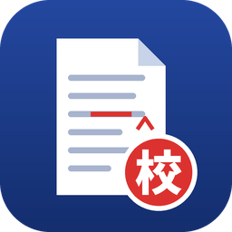

# 明細書AI校正（patentproof）for Olares

特許明細書（.docx）を、Olares 上のローカル LLM で事務校正するアプリです。
明細書は Olares の外に送信しません。

## できること

- Home/Documents 内の明細書 .docx を一覧から選んで校正
- 観点（誤字・誤変換／用語の不統一／表記ゆれ／口語・不自然な表現／符号の不一致）ごとに LLM でチェックし、3回の多数決で確信度を付与
- 3回とも一致した小さな修正は **変更履歴**、それ以外は **コメント（【要確認】）** として同じフォルダに保存
  - `【AI校正】<元のファイル名>.docx`
  - `<元のファイル名>_修正箇所一覧.csv`（検出回数付き）
- 同じフォルダに図面PDF（ファイル名に「図」を含む）があれば、OCR で符号を読み取り明細書と照合（任意）

## 必要なもの

| 必須／任意 | アプリ | 用途 |
|---|---|---|
| 必須 | LLM（Market の「Qwen3.8-27B (llama.cpp)」など、Olares Router 経由で使えるもの） | 校正本体 |
| 任意 | PaddleOCR（Market） | 図面PDFの符号照合 |

日本語に強い 27B クラス以上のモデルを推奨します。

## インストール

1. [Releases](https://github.com/ryosk7/olares-patentproof/releases) から `patentproof-<version>.tgz` を取得する（またはこのリポジトリで `tar czf patentproof-<version>.tgz patentproof` を実行して作る）
2. Olares の **Market → 自分のOlares → カスタムアプリパッケージをアップロード** で tgz を選ぶ
3. インストール後、アプリを開き **「設定・接続確認」** を開く
   - **LLM の URL**: 設定 → アプリ → （LLM アプリ）→ 共有エントランス に表示される URL の末尾に `/v1` を付けたもの
   - **モデル**: URL を保存すると一覧が出るので選ぶ
   - **OCR の URL**（任意）: 設定 → アプリ → PaddleOCR → 共有エントランス の URL
   - 「保存して接続確認」で両方「接続できます」になれば準備完了

インストール時の既定値は Olares の環境変数（設定 → アプリ → 明細書AI校正 → 環境変数）でも変更できます。
アプリ内の設定画面で保存した値のほうが優先されます。

## 使い方

1. 明細書 .docx（と図面PDF）を Home/Documents 内の任意のフォルダに置く
2. 図面照合を使う場合は、先に **「ルールのみ」** を実行（数秒〜十数秒）
   - 図面を OCR で読み取り、`<図面PDF名>_OCR.txt` として保存します
3. **PaddleOCR を停止してから**、**「校正する」** でフル実行（2万字で約40分）
4. 完了後、同じフォルダの `【AI校正】…docx` を Word や OnlyOffice で開き、変更履歴とコメントを確認

> **注意（GPU）**: LLM と OCR は同時に動かすと GPU／メモリ不足で LLM が停止することがあります。
> OCR の読み取り（ルールのみ）とフル実行は分けて行い、フル実行中は PaddleOCR を停止してください。

## 精度の目安（参考）

約2万字の検証用明細書（人手で確認した誤記18項目）で、約6割を検出（Qwen3.8-27B, 推論 low, 多数決3回）。
変更履歴として自動反映した指摘はほぼすべて妥当、コメントは担当者による取捨選択が必要です。
最終確認は必ず人が行ってください。

## 設定項目

| 項目 | 既定 | 説明 |
|---|---|---|
| 推論の深さ | low | medium / xhigh で精度が上がる代わりに数倍遅くなる |
| 多数決の回数 | 3 | 全回一致の指摘だけ変更履歴にする |
| 同時実行数 | 2 | LLM 側の同時実行上限に合わせる |
| 校正方針 | （既定の方針） | 事務所の校正マニュアルなどを貼り付けると、すべてのチェックの指示に使われる |

## 動作環境

- Olares 1.12.6 以降（amd64 / arm64）
- 初回起動時に PyPI から python-docx / pypdf を取得するため、インターネット接続が必要

## ライセンス

MIT
